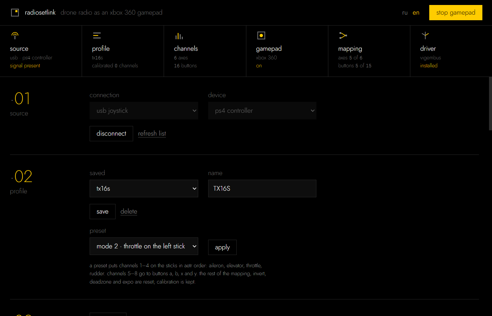
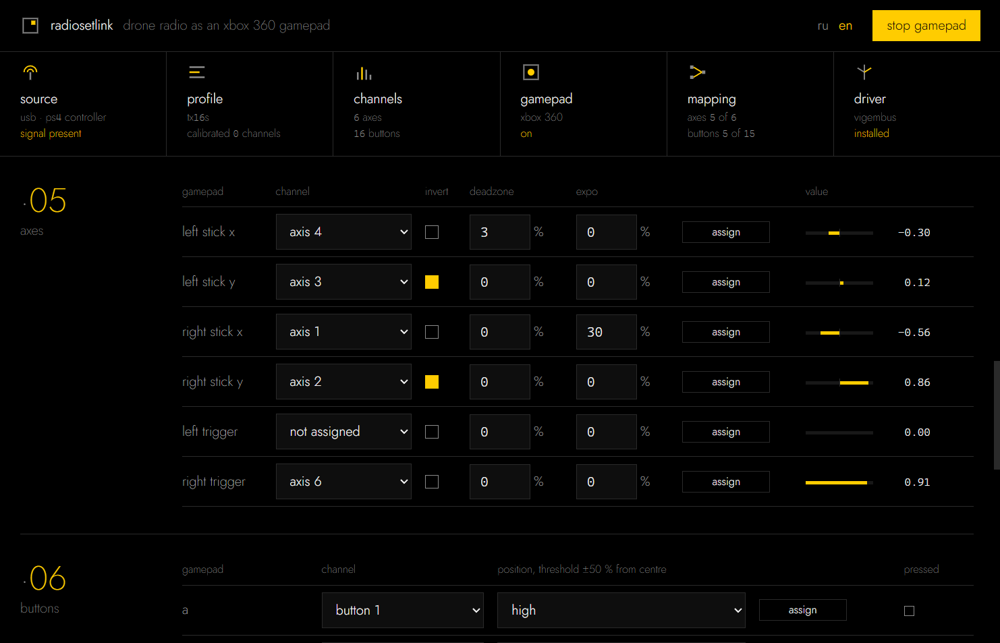
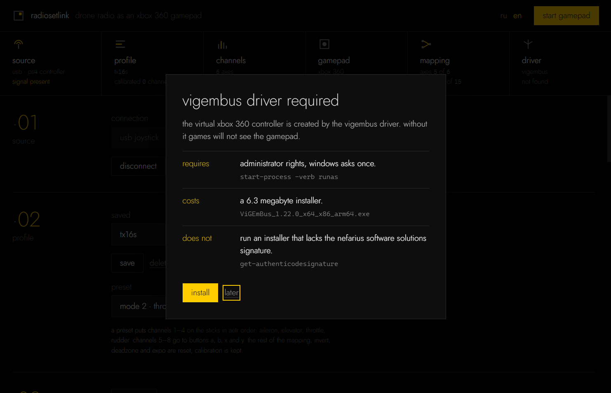

[Русский](README.md) · **English**

# RadioSetLink

RadioSetLink turns a drone radio into an Xbox 360 controller on Windows. In USB
Joystick mode Windows sees the radio as a HID joystick, while XInput games see
only Xbox-compatible controllers. The app reads the radio over USB, or an
ExpressLRS receiver over a COM port, and hands the channels to a virtual Xbox
360 controller through the ViGEmBus driver.



## Sources, mapping, calibration

- **USB HID** — EdgeTX and OpenTX radios on a cable in joystick mode. The path is
  checked by an end-to-end test on a virtual DualShock 4; the app has not been
  run with a real radio.
- **CRSF over a COM port** — an ExpressLRS or Crossfire receiver on a USB-UART
  adapter, 420000 baud by default. Frame parsing is checked by 8 tests on
  synthetic bytes; the app has not been run with a real receiver.
- **Mode 2 and Mode 1 presets** — channels 1–4 go to the sticks in AETR order,
  channels 5–8 to buttons a, b, x and y. The rest of the mapping is reset.
- **Assign by moving** — after Assign the app takes the channel that moved more
  than 25 % of its full travel.
- **Invert, deadzone up to 50 % and expo up to 100 %** — separate for each of
  the 6 axes.
- **Switches as buttons** — a button fires in the high, middle or low position
  of a channel with a ±50 % threshold from centre, so a three-position switch
  presses three different buttons.
- **Calibration** — the minimum and maximum of every channel go into the
  profile, and a throttle without a spring reaches full travel.
- **Saved layouts** — JSON files in `%APPDATA%\RadioSetLink\profiles`, names up to
  64 characters.
- **Reconnect** — a lost source is reopened once a second.
- **Driver** — if ViGEmBus is missing, the app runs the 6.3 megabyte ViGEmBus
  1.22.0 installer, and only when it carries the Nefarius Software Solutions
  signature.
- **Languages** — Russian and English, switchable without a restart.

## Ready-made exe and source

Download `RadioSetLink.exe` from [releases](../../releases/latest) and run it.
No Python needed, and the driver installer is already inside. The window needs
the Microsoft Edge WebView2 Runtime, which Windows 11 already has.

From source you need Python 3.10 or newer.

```powershell
python -m venv .venv
```

```powershell
.venv\Scripts\pip install -r requirements.txt
```

```powershell
.venv\Scripts\python.exe main.py
```

## EdgeTX and ExpressLRS receiver

**EdgeTX or OpenTX radio.** Plug the radio in and pick "USB Joystick (HID)" in
the menu that appears. Channels CH1–CH8 arrive as axes in the model's channel
order. The presets assume AETR; EdgeTX sets the default order in Radio Setup →
Default channel order.

**ExpressLRS receiver.** The receiver TX goes to the RX of a USB-UART adapter,
plus 5 V power and ground. The receiver has to be bound to the radio. In the app
pick "CRSF over COM port" and the adapter's port.

## Connect, calibrate, preset, start

1. Pick the connection type and device, press Connect. The bars in section 03
   start moving with the sticks.
2. Press Calibrate, move every stick and switch to its end points, press Done.
3. Pick the Mode 2 or Mode 1 preset and press Apply. If an axis moves the wrong
   way, tick Invert. Buttons work the same way, through Assign and a flick of
   the switch.
4. Save the profile and press Start gamepad. The game will see an Xbox 360
   controller.



## ViGEmBus driver

The virtual gamepad is created by the [ViGEmBus](https://github.com/nefarius/ViGEmBus)
driver. If it is missing, a setup dialog opens on start. The app takes the
installer from the build, or when running from source downloads it from the
official releases page, checks the Nefarius Software Solutions digital
signature and runs it with an administrator prompt.



## Files

```
rsl/
  app.py        pywebview window and engine start-up
  api.py        methods the interface calls
  engine.py     polling thread: source → mapping → gamepad
  sources.py    USB joystick through SDL and CRSF over a COM port
  mapping.py    profile, calibration, deadzone, expo, button conditions
  output.py     Xbox 360 report from axes and buttons
  vigem.py      ViGEmClient.dll through ctypes
  driver.py     ViGEmBus detection, download and setup
  store.py      profiles and settings in %APPDATA%\RadioSetLink
  ui/           interface, styles, Jost font, translations, icon
  bin/          ViGEmClient.dll for x64 and x86
tests/          automated tests, including an end-to-end one through XInput
docs/           screenshots, screenshot script, GitHub texts
assets/         icon generator
build_exe.py    exe build
```

## Polling, CRSF and calibration

**Polling.** The engine sleeps 4 ms between steps, so it makes at most 250 steps
a second, and the interface redraws every 33 ms. Every step reads the source,
scales all channels to −1…1, applies calibration and the profile, and sends a
report to the virtual gamepad only when something changed.

**CRSF.** The `0x16` channels frame carries 16 values of 11 bits each. The app
finds frame starts in the byte stream, checks CRC8 with polynomial `0xD5` and
skips telemetry and noise. If no frame arrives for 0.5 s, outputs return to
neutral.

**Calibration.** While calibrating, the minimum and maximum of every channel are
recorded, and that span is then stretched over the full range. A throttle
resting at the bottom becomes zero in the middle and one at the top. A channel
that moved less than 10 % of its full travel keeps its old calibration.

## Tests and screenshots

```powershell
.venv\Scripts\python.exe -m unittest discover -s tests -t .
```

There are 51 tests. The end-to-end one creates a virtual DualShock 4 in place of
a radio, runs it through RadioSetLink and reads the virtual Xbox 360 back
through XInput. It is skipped without ViGEmBus.

Screenshots are regenerated by `docs\make_screenshots.py`. It also uses a
virtual DualShock 4 as the source, which is why the device list shows
"ps4 controller". The script needs Pillow and an installed ViGEmBus.

## Building the exe

```powershell
.venv\Scripts\pip install pyinstaller pillow
```

```powershell
.venv\Scripts\python.exe build_exe.py
```

The result is `release\RadioSetLink.exe`. The script downloads the ViGEmBus
installer, checks its signature and bundles it into the exe. The icon is
regenerated by `assets\make_icon.py`, which needs Pillow too.

## What the app does not do

- It runs only on Windows, because the virtual gamepad is built on ViGEmBus.
- The output is a single Xbox 360 controller. Games that only understand
  DirectInput or the keyboard will not see it.
- Some online games with anti-cheat reject virtual controllers.
- CRSF needs a receiver on a USB-UART adapter. Modules and radios that expose
  CRSF some other way are not supported.
- The app has not been tested with real radios and receivers. Reports about
  them are welcome in [issues](../../issues).
- The build is not code signed, so Windows SmartScreen warns about an unknown
  publisher on first launch.

## Licences, font and theme

The code is MIT licensed, see [LICENSE](LICENSE).

The look is the module theme of the Lodd house standard. It has a flat black
background, one yellow accent `#ffcc00`, weights 200 and 300 and lower case
everywhere. The [Jost](https://github.com/indestructible-type/Jost) font ships
in `rsl/ui/fonts` under SIL OFL 1.1 (`rsl/ui/fonts/OFL.txt`).

`ViGEmClient.dll` comes from [vgamepad](https://github.com/yannbouteiller/vgamepad)
(MIT, `rsl/bin/LICENSE-vgamepad`) and belongs to the
[ViGEm](https://github.com/nefarius/ViGEmClient) project. The ViGEmBus driver
belongs to Nefarius Software Solutions and is not part of this repository.
