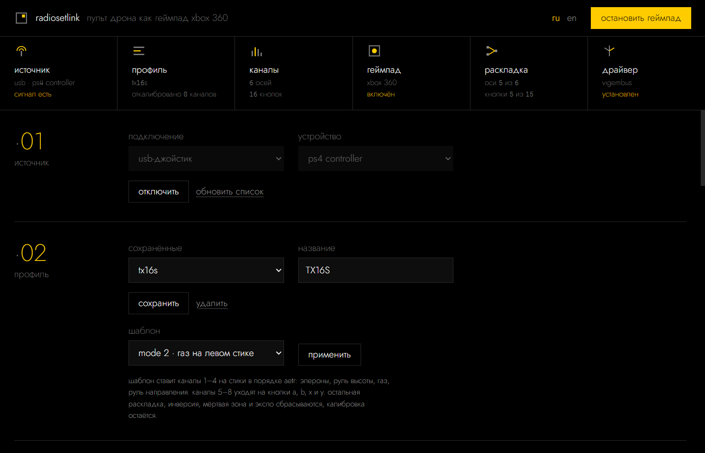
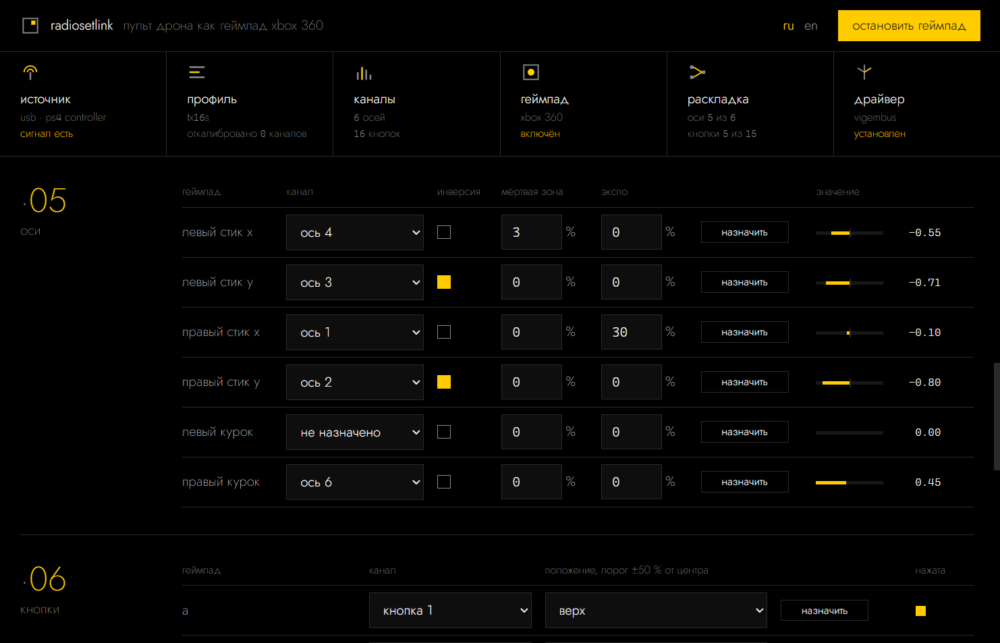
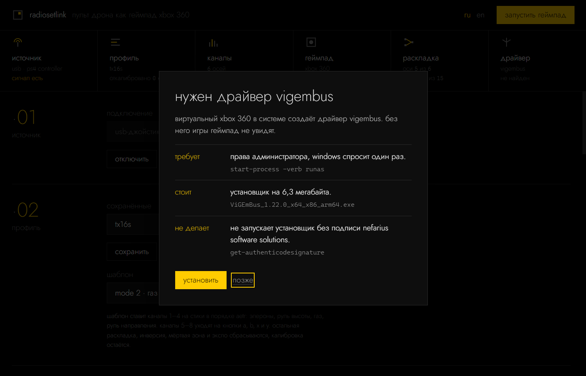

**Русский** · [English](README.en.md)

# RadioSetLink

RadioSetLink превращает пульт дрона в контроллер Xbox 360 для Windows. Пульт в
режиме USB Joystick система видит как HID-джойстик, а игры на XInput видят
только Xbox-совместимые контроллеры. Программа читает пульт по USB или приёмник
ExpressLRS через COM-порт и отдаёт каналы виртуальному Xbox 360 через драйвер
ViGEmBus.



## Источники, раскладка, калибровка

- **USB-джойстик** — пульты на EdgeTX и OpenTX в режиме USB Joystick. Путь
  проверен сквозным тестом на виртуальном DualShock 4, с настоящим пультом
  программа не запускалась.
- **CRSF через COM-порт** — приёмник ExpressLRS или Crossfire на USB-UART
  адаптере, 420000 бод по умолчанию. Разбор кадров проверен 8 тестами на
  синтетических байтах, с настоящим приёмником программа не запускалась.
- **Шаблоны Mode 2 и Mode 1** — каналы 1–4 уходят на стики в порядке AETR,
  каналы 5–8 на кнопки a, b, x и y. Остальная раскладка при этом сбрасывается.
- **Назначение движением** — после «Назначить» программа берёт канал, который
  сдвинулся больше чем на 25 % полного хода.
- **Инверсия, мёртвая зона до 50 % и экспо до 100 %** — у каждой из 6 осей свои.
- **Тумблеры как кнопки** — кнопка срабатывает в верхнем, среднем или нижнем
  положении канала с порогом ±50 % от центра, поэтому трёхпозиционный тумблер
  нажимает три разные кнопки.
- **Калибровка** — минимум и максимум каждого канала записываются в профиль, и
  газ без пружины доходит до полного хода.
- **Профили** — JSON-файлы в `%APPDATA%\RadioSetLink\profiles`, имя до 64 знаков.
- **Переподключение** — потерянный источник программа открывает заново раз в
  секунду.
- **Драйвер** — если ViGEmBus нет, программа запускает установщик ViGEmBus
  1.22.0 на 6,3 мегабайта и только с подписью Nefarius Software Solutions.
- **Языки** — русский и английский, переключаются без перезапуска.

## Готовый exe и исходники

Скачайте `RadioSetLink.exe` из [релизов](../../releases/latest) и запустите.
Python ставить не нужно, установщик драйвера уже внутри. Окну нужен Microsoft
Edge WebView2 Runtime, в Windows 11 он уже есть.

Из исходников нужен Python 3.10 или новее.

```powershell
python -m venv .venv
```

```powershell
.venv\Scripts\pip install -r requirements.txt
```

```powershell
.venv\Scripts\python.exe main.py
```

## EdgeTX и приёмник ExpressLRS

**Пульт на EdgeTX или OpenTX.** Подключите пульт кабелем и в появившемся меню
выберите «USB Joystick (HID)». Каналы CH1–CH8 придут как оси в порядке каналов
модели. Шаблоны рассчитаны на AETR, порядок по умолчанию задаётся в EdgeTX в
Radio Setup → Default channel order.

**Приёмник ExpressLRS.** TX приёмника идёт на RX USB-UART адаптера, к нему
питание 5 В и земля. Приёмник должен быть связан с пультом. В программе
выберите «CRSF через COM-порт» и порт адаптера.

## Подключение, калибровка, шаблон, запуск

1. Выберите тип подключения и устройство, нажмите «Подключить». Столбики в
   разделе 03 начнут двигаться вместе со стиками.
2. Нажмите «Калибровка», отведите все стики и тумблеры в крайние положения,
   нажмите «Готово».
3. Выберите шаблон Mode 2 или Mode 1 и нажмите «Применить». Если ось едет не в
   ту сторону, поставьте «Инверсию». Кнопки назначаются так же, через
   «Назначить» и щелчок тумблером.
4. Сохраните профиль и нажмите «Запустить геймпад». Игра увидит контроллер
   Xbox 360.



## Драйвер ViGEmBus

Виртуальный геймпад создаёт драйвер [ViGEmBus](https://github.com/nefarius/ViGEmBus).
Если его нет, при запуске откроется окно установки. Программа берёт установщик
из сборки, а при запуске из исходников скачивает его с официальной страницы
релизов, проверяет цифровую подпись Nefarius Software Solutions и запускает с
запросом прав администратора.



## Файлы

```
rsl/
  app.py        окно pywebview и запуск движка
  api.py        методы, которые вызывает интерфейс
  engine.py     поток опроса: источник → раскладка → геймпад
  sources.py    USB-джойстик через SDL и CRSF через COM-порт
  mapping.py    профиль, калибровка, мёртвая зона, экспо, условия кнопок
  output.py     отчёт Xbox 360 из осей и кнопок
  vigem.py      обращение к ViGEmClient.dll через ctypes
  driver.py     проверка, загрузка и установка ViGEmBus
  store.py      профили и настройки в %APPDATA%\RadioSetLink
  ui/           интерфейс, стили, шрифт Jost, переводы, иконка
  bin/          ViGEmClient.dll для x64 и x86
tests/          автотесты, включая сквозной через XInput
docs/           скриншоты, скрипт скриншотов, тексты для GitHub
assets/         генератор иконки
build_exe.py    сборка в exe
```

## Опрос, CRSF и калибровка

**Опрос.** Между шагами движок спит 4 мс, то есть делает не больше 250 шагов в
секунду, а интерфейс перерисовывается раз в 33 мс. Каждый шаг движок читает
источник, приводит все каналы к диапазону от −1 до 1, применяет калибровку и
профиль и отправляет отчёт виртуальному геймпаду, только если что-то
изменилось.

**CRSF.** Кадр каналов `0x16` содержит 16 значений по 11 бит. Программа ищет
начало кадра в потоке байт, проверяет CRC8 с полиномом `0xD5` и пропускает
телеметрию и мусор. Если кадров нет дольше 0,5 с, выходы сбрасываются в
нейтраль.

**Калибровка.** За время калибровки запоминаются минимум и максимум каждого
канала, и дальше этот отрезок растягивается на весь диапазон. Поэтому газ,
который стоит внизу, в центре станет нулём, а вверху — единицей. Канал, который
сдвинулся меньше чем на 10 % полного хода, калибровка не трогает.

## Тесты и скриншоты

```powershell
.venv\Scripts\python.exe -m unittest discover -s tests -t .
```

Тестов 51. Сквозной создаёт виртуальный DualShock 4 вместо пульта, пропускает
его через RadioSetLink и читает результат с виртуального Xbox 360 через XInput.
Без ViGEmBus он пропускается.

Скриншоты пересоздаёт `docs\make_screenshots.py`. Источником в нём тоже служит
виртуальный DualShock 4, поэтому в списке устройств видно «ps4 controller».
Скрипту нужны Pillow и установленный ViGEmBus.

## Сборка exe

```powershell
.venv\Scripts\pip install pyinstaller pillow
```

```powershell
.venv\Scripts\python.exe build_exe.py
```

Результат — `release\RadioSetLink.exe`. Скрипт сам скачает установщик ViGEmBus,
проверит подпись и положит его внутрь exe. Иконку пересоздаёт
`assets\make_icon.py`, ему тоже нужен Pillow.

## Чего программа не делает

- Работает только в Windows, потому что виртуальный геймпад построен на
  ViGEmBus.
- Выход — один контроллер Xbox 360. Игры, которые понимают только DirectInput
  или клавиатуру, его не увидят.
- Некоторые онлайн-игры с античитом не принимают виртуальные контроллеры.
- Для CRSF нужен приёмник на USB-UART адаптере. Модули и пульты, которые
  отдают CRSF иначе, не поддерживаются.
- С настоящими пультами и приёмниками программа не проверялась. Отзывы о них —
  в [issues](../../issues).
- Сборка не подписана сертификатом, поэтому Windows SmartScreen при первом
  запуске предупредит о неизвестном издателе.

## Лицензии, шрифт и тема

Код под лицензией MIT, см. [LICENSE](LICENSE).

Внешний вид — тема module из домашнего стандарта Lodd. В ней плоский чёрный
фон, один жёлтый акцент `#ffcc00`, начертания 200 и 300 и строчные буквы.
Шрифт [Jost](https://github.com/indestructible-type/Jost) лежит в
`rsl/ui/fonts` под лицензией SIL OFL 1.1 (`rsl/ui/fonts/OFL.txt`).

`ViGEmClient.dll` взята из [vgamepad](https://github.com/yannbouteiller/vgamepad)
(MIT, `rsl/bin/LICENSE-vgamepad`) и относится к проекту
[ViGEm](https://github.com/nefarius/ViGEmClient). Драйвер ViGEmBus принадлежит
Nefarius Software Solutions и в репозиторий не входит.
